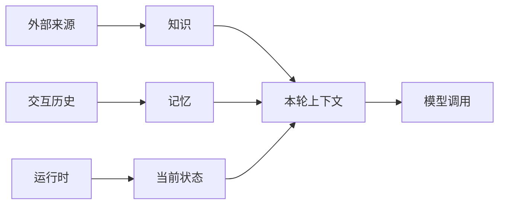

# 第 01 章：基础概念、理论模型与研究边界

[全书首页](../../README.md) · [下一章](../02-representation/README.md)

## 问题导读与阅读顺序

模型已经知道很多，为什么还需要外部系统？ 知识、记忆、状态和上下文分别是什么？ 知识工程为什么不只是搜索文档？ 什么样的持久化才算 Agent 记忆？ 如何统一底座而不抹平差异？

- [1.1 AI 系统的信息基础](01.md)
- [1.2 核心概念体系](02.md)
- [1.3 知识工程理论](03.md)
- [1.4 记忆工程理论](04.md)
- [1.5 知识与记忆的统一理论模型](05.md)

## 本章模型

以下为参考设计，箭头表示处理方向或职责联系，不代表已部署组件。

## 章节关系

本章定义概念，第二章落实表示，第三章再研究形成。

## 配套产出

- [贯穿案例](../appendices/atlas-case.md)
- [模型和示例](../../examples/README.md)
- [API 契约](../appendices/api-contract.md)
- [实验执行规程](../appendices/evaluation-protocol.md)
