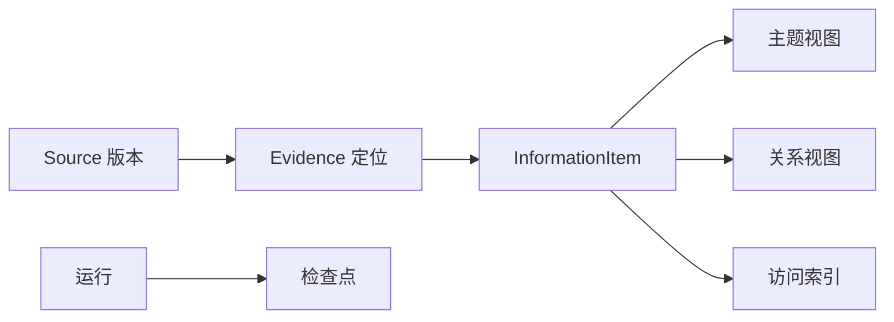

# 第 02 章：信息分类体系与知识表示模型

[全书首页](../../README.md) · [上一章](../01-foundations/README.md) · [下一章](../03-formation/README.md)

## 问题导读与阅读顺序

信息应按什么维度分类？ 记忆层次与内容为何要分开？ 哪些管理字段决定能否使用信息？ 原文、Claim、Wiki、图谱与向量如何协作？ 统一模型如何保持可验证性？

- [2.1 信息的语义分类](01.md)
- [2.2 记忆的结构与分类](02.md)
- [2.3 信息的管理维度](03.md)
- [2.4 知识与记忆的表示形式](04.md)
- [2.5 统一数据模型](05.md)

## 本章模型

以下为参考设计，箭头表示处理方向或职责联系，不代表已部署组件。

## 章节关系

本章定义逻辑结构，第三章填充对象，第七章选择物理实现。

## 配套产出

- [贯穿案例](../appendices/atlas-case.md)
- [模型和示例](../../examples/README.md)
- [API 契约](../appendices/api-contract.md)
- [实验执行规程](../appendices/evaluation-protocol.md)
