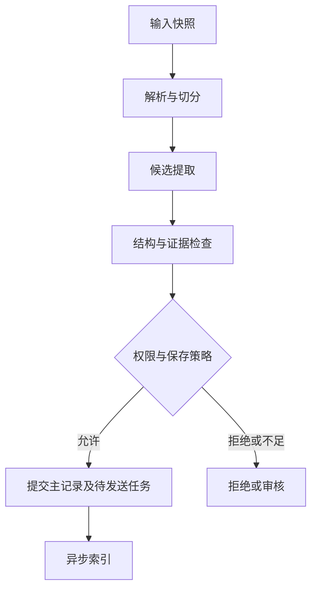

# 第 03 章：知识与记忆的形成机制

[全书首页](../../README.md) · [上一章](../02-representation/README.md) · [下一章](../04-lifecycle/README.md)

## 问题导读与阅读顺序

本章介绍信息从采集到写入的处理过程，在各小节中结合 LlamaIndex、Mem0、Letta Code 和 LangGraph 的具体实现，分析处理流程、数据变化和设计取舍。Atlas 的配套实验用于观察候选验证、保存决策和失败处理。

实验默认离线；候选及语义判定为教材预设，不是模型实测输出。实际运行记录与预期结果分开保存；可选真实模型入口默认不自动批准新输出。

采集如何保留出处和权限？ 预处理怎样保住语义？ 怎样提取有证据的知识？ 交互中什么值得成为记忆？ 提取后为何还要筛选？ 怎样可靠执行写入？

- [3.1 信息获取机制（Acquisition）](01.md)
- [3.2 信息预处理（Preprocessing）](02.md)
- [3.3 知识提取（Knowledge Extraction）](03.md)
- [3.4 记忆提取（Memory Extraction）](04.md)
- [3.5 信息价值判断（Information Selection）](05.md)
- [3.6 信息写入机制（Write Pipeline）](06.md)

各节的源码链接固定到具体提交。LlamaIndex、Mem0 和 Letta Code 采用源码分析；LangGraph 的 Store 与检查点还附有官方包的实际运行结果。代码推演与实际运行分别标明。

## 本章模型

以下为参考设计，箭头表示处理方向或职责联系，不代表已部署组件。

图中的待发送任务常称为 outbox（事务发件箱）：主记录与任务在同一数据库事务中保存，再由后台读取任务，执行索引等后续工作。这样可以避免主记录已提交、进程却在发送通知前退出，导致后续任务遗漏。它不保证所有外部动作只执行一次，具体边界见[写入机制](06.md)。

## 章节关系

本章负责首次形成与写入，长期演进由第四章处理。

## 配套产出

- [贯穿案例](../appendices/atlas-case.md)
- [模型和示例](../../examples/README.md)
- [API 契约](../appendices/api-contract.md)
- [实验执行规程](../appendices/evaluation-protocol.md)
- [第三章实验手册](../../labs/formation/README.md)
- [实际离线轨迹](../../labs/formation/fixtures/recorded-run.json)
