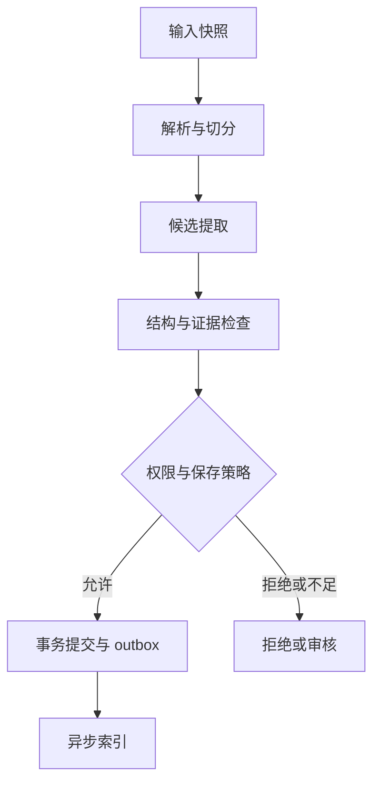

# 第 03 章：知识与记忆的形成机制

[全书首页](../../README.md) · [上一章](../02-representation/README.md) · [下一章](../04-lifecycle/README.md)

## 问题导读与阅读顺序

本章已深化为可运行案例版：以同一批 Atlas 文档、对话和工具轨迹贯穿六节，解释每条信息为什么保存、拒绝或等待审核。先阅读正文，再运行[Node.js 实验](../../labs/formation/README.md)，最后修改输入检查失败路径。

实验默认离线；候选及语义判定为教材预设，不是模型实测输出。实际运行记录与预期结果分开保存；可选真实模型入口默认不自动批准新输出。

采集如何保留出处和权限？ 预处理怎样保住语义？ 怎样提取有证据的知识？ 交互中什么值得成为记忆？ 提取后为何还要筛选？ 怎样可靠执行写入？

- [3.1 信息获取机制（Acquisition）](01.md)
- [3.2 信息预处理（Preprocessing）](02.md)
- [3.3 知识提取（Knowledge Extraction）](03.md)
- [3.4 记忆提取（Memory Extraction）](04.md)
- [3.5 信息价值判断（Information Selection）](05.md)
- [3.6 信息写入机制（Write Pipeline）](06.md)

## 本章模型

以下为参考设计，箭头表示处理方向或职责联系，不代表已部署组件。

## 章节关系

本章负责首次形成与写入，长期演进由第四章处理。

## 配套产出

- [贯穿案例](../appendices/atlas-case.md)
- [模型和示例](../../examples/README.md)
- [API 契约](../appendices/api-contract.md)
- [实验执行规程](../appendices/evaluation-protocol.md)
- [第三章实验手册](../../labs/formation/README.md)
- [实际离线轨迹](../../labs/formation/fixtures/recorded-run.json)
