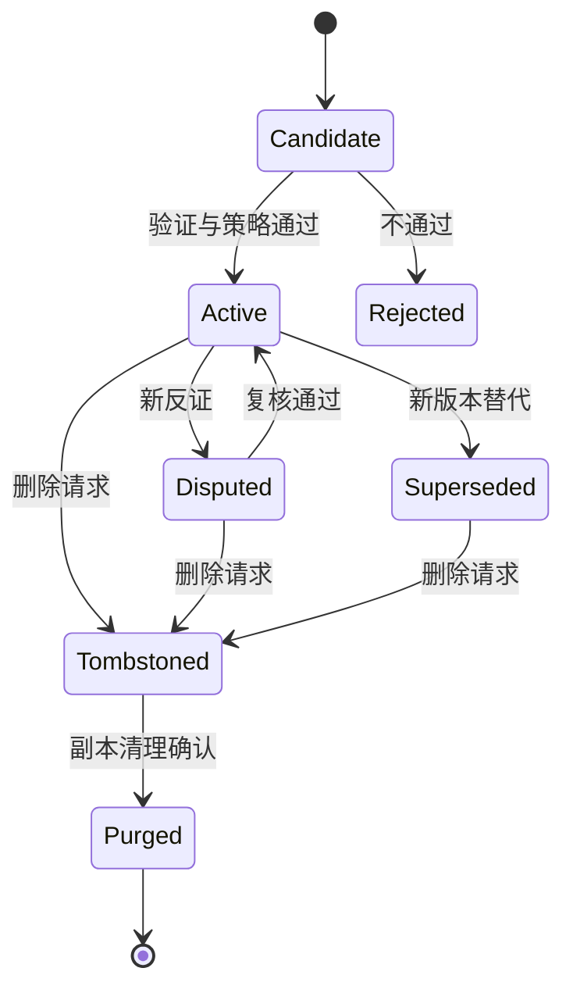

# 第 04 章：知识与记忆的生命周期及演进机制

[全书首页](../../README.md) · [上一章](../03-formation/README.md) · [下一章](../05-retrieval-context/README.md)

## 问题导读与阅读顺序

信息可以相信到什么程度？ 去重、融合与巩固有何不同？ 遇到矛盾怎么办？ 来源变化后怎样更新派生知识？ 记忆如何演进而不制造错误？ 治理怎样覆盖所有副本？

- [4.1 信息验证](01.md)
- [4.2 信息去重与融合](02.md)
- [4.3 信息冲突管理](03.md)
- [4.4 知识演进](04.md)
- [4.5 记忆演进](05.md)
- [4.6 生命周期治理](06.md)

## 本章模型

以下为参考设计，箭头表示处理方向或职责联系，不代表已部署组件。

## 章节关系

本章负责治理，第五章在访问时执行状态与权限约束。

## 配套产出

- [贯穿案例](../appendices/atlas-case.md)
- [模型和示例](../../examples/README.md)
- [API 契约](../appendices/api-contract.md)
- [实验执行规程](../appendices/evaluation-protocol.md)
