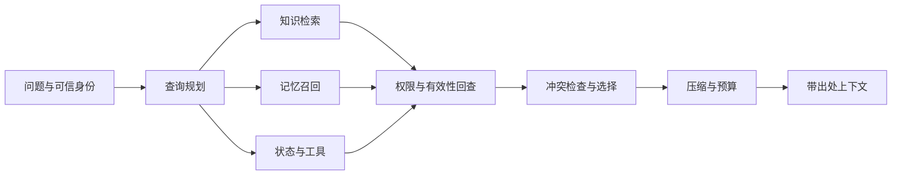

# 第 05 章：信息检索、记忆召回与上下文工程

[全书首页](../../README.md) · [上一章](../04-lifecycle/README.md) · [下一章](../06-architecture/README.md)

## 问题导读与阅读顺序

不同查询应该走哪条访问路径？ RAG 的变化究竟改变了什么？ 记忆召回与一般文档检索有什么不同？ 上下文工程怎样把相关信息变成有用输入？ 知识、记忆和状态如何联合访问？

- [5.1 信息访问基础](01.md)
- [5.2 RAG 技术体系](02.md)
- [5.3 记忆召回机制](03.md)
- [5.4 Context Engineering](04.md)
- [5.5 知识与记忆联合访问](05.md)

## 本章模型

以下为参考设计，箭头表示处理方向或职责联系，不代表已部署组件。

## 章节关系

本章负责选择和利用，第六章定义协作，第七章选择实现。

## 配套产出

- [贯穿案例](../appendices/atlas-case.md)
- [模型和示例](../../examples/README.md)
- [API 契约](../appendices/api-contract.md)
- [实验执行规程](../appendices/evaluation-protocol.md)
