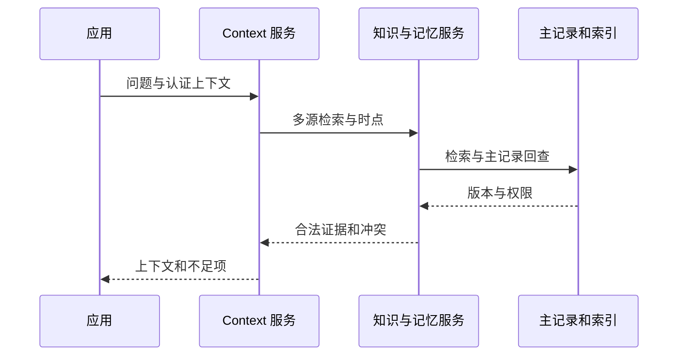

# 第 06 章：统一知识与记忆基础设施架构设计

[全书首页](../../README.md) · [上一章](../05-retrieval-context/README.md) · [下一章](../07-engineering/README.md)

## 问题导读与阅读顺序

逻辑架构需要从一开始拆微服务吗？ 五层分别承担什么责任？ 模块边界如何防止职责混乱？ 核心数据流在哪些点交接？ 接口如何表达版本与部分失败？ 多租户与 Agent 运行时如何集成？

- [6.1 总体架构原则](01.md)
- [6.2 系统逻辑分层](02.md)
- [6.3 核心服务模块](03.md)
- [6.4 系统核心数据流](04.md)
- [6.5 模块通信与接口设计](05.md)
- [6.6 多租户与 Agent 集成](06.md)

## 本章模型

以下为参考设计，箭头表示处理方向或职责联系，不代表已部署组件。

## 章节关系

本章不绑定框架，第七章比较技术，第八章验证架构收益。

## 配套产出

- [贯穿案例](../appendices/atlas-case.md)
- [模型和示例](../../examples/README.md)
- [API 契约](../appendices/api-contract.md)
- [实验执行规程](../appendices/evaluation-protocol.md)
