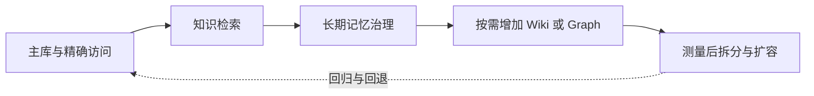

# 第 07 章：技术选型、核心实现原理与架构演进

[全书首页](../../README.md) · [上一章](../06-architecture/README.md) · [下一章](../08-evaluation/README.md)

## 问题导读与阅读顺序

各种存储各自适合什么？ 怎样组合不同知识组织方式？ 记忆系统从哪里开始实现？ 选型如何比较而不变成排行榜？ 哪些工程细节决定可靠性？ 怎样形成可复核的选型决策？ 架构应按什么顺序演进？

- [7.1 数据库与持久化技术](01.md)
- [7.2 知识组织技术](02.md)
- [7.3 记忆实现技术](03.md)
- [7.4 核心技术选型比较](04.md)
- [7.5 工程实现原理](05.md)
- [7.6 技术选型决策体系](06.md)
- [7.7 分阶段架构演进](07.md)

## 本章模型

以下为参考设计，箭头表示处理方向或职责联系，不代表已部署组件。

## 章节关系

本章给出候选技术，第八章实验决定是否采用。

## 配套产出

- [贯穿案例](../appendices/atlas-case.md)
- [模型和示例](../../examples/README.md)
- [API 契约](../appendices/api-contract.md)
- [实验执行规程](../appendices/evaluation-protocol.md)
